<h1 align="center">Delegent</h1>

<p align="center">
  <b>Your AI agents ask before they act.</b><br>
  A gateway between your agents and the tools they use. It asks you first, and it keeps your credentials.
</p>

<p align="center">
  
  
  
  
</p>

<p align="center">
  <a href="#what-you-see">What you see</a> ·
  <a href="#how-it-works">How it works</a> ·
  <a href="#install">Install</a> ·
  <a href="#quick-start">Quick start</a> ·
  <a href="#approving-requests">Approving requests</a> ·
  <a href="#dashboards">Dashboards</a> ·
  <a href="#a-shared-gateway-for-a-team">For a team</a> ·
  <a href="#limits">Limits</a>
</p>

---

AI agents get things done through tools: an MCP server for GitHub, one for Stripe, one for
your database. To use a tool, the agent is normally handed your access token. From then on
it can do anything that token allows, and nobody is asked.

Delegent sits between your agents and those tools:

1. **Your agents never hold your credentials.** They connect to Delegent with a key that
   works only there. Delegent adds the real token when it forwards a call.
2. **Every tool is classified** as reading, writing, destructive, spending money or reaching
   outside. A tool Delegent cannot classify is refused until you classify it.
3. **You are asked before a call runs**, unless you already approved that kind of call. The
   question reaches you in the agent's own chat, in a dashboard, in the terminal or on
   Telegram.
4. **An approval is narrow and it expires.** It covers the permissions you ticked, for the
   time you set. A call that spends money always asks.
5. **Decisions are recorded** in a signed log that can be checked later, without trusting
   Delegent.

It is one program. There is no database and no account: its state is a folder of files on
your machine, with your credentials encrypted under a key that stays there.

## What you see

When an agent tries something you have not approved, the call waits and you get a question
like this:

```text
claude-code wants to Create an issue on github — ✍️ writes data.
Why: "file the login bug we just reproduced"
```

The first line is what Delegent knows: which agent, which tool, which service, and what kind
of action it is. The "Why" is the agent's own explanation. You approve or deny. When you
approve, you choose which permissions to grant and for how long.

## How it works

<picture>
  <source media="(prefers-color-scheme: dark)" srcset="docs/architecture-dark.svg">
  
</picture>

| Step | What happens |
|---|---|
| **Call** | Your agent calls a tool through Delegent, using its Delegent key. The tools of all your servers arrive in one list, named `<server>__<tool>`, for example `github__create_issue`. |
| **Check** | Delegent looks up what the tool does and which permissions it needs, whether this agent may use this server at all, and whether an approval already covers the call. |
| **Ask** | If nothing covers it, you are asked, and the call is held while you decide. If you take longer than about half a minute, the agent is told the request is pending and can try again once you have answered. |
| **Forward** | Delegent adds the real credential and sends the call on. The credential goes only to the address you configured for that server. |
| **Record** | Every approval and refusal is written to a signed, chained receipt log. Every call is written to an activity log you can read in the dashboard. |

## Install

```sh
curl -fsSL https://delegent.dev/install.sh | sh
```

This installs `delegent` for macOS or Linux (Intel/AMD and ARM) and checks the download
against its published checksum. It also installs `delegent-proto`, a small tool for checking
the receipt log.

With Go: `go install delegent.dev/gateway/cmd/delegent@latest`

> [!NOTE]
> Both commands install the latest release, v0.3.5. The web dashboard and agents as targets
> (A2A) are newer than that release. To use them today, build from source with Go 1.25 or
> newer:
>
> ```sh
> git clone https://github.com/iluxav/delegent && cd delegent && make install
> ```

## Quick start

About five minutes. You need one MCP server to put behind Delegent, and the token you
normally give your agent for it.

**1. Create your Delegent home**

```sh
delegent init
```

This creates `~/.delegent` with an encryption key and your settings. Back up
`~/.delegent/master.key`: without it, the credentials you store cannot be read.

**2. Add a server**

```sh
delegent target add --id github \
  --endpoint https://api.githubcopilot.com/mcp/ \
  --credential <your GitHub token>
```

Delegent connects to the server, lists its tools and drafts a classification for each one.
The token is stored encrypted. Any MCP server reachable over HTTP works the same way.

**3. Create a key for your agent**

```sh
delegent key mint --name laptop
```

The key is shown once. It is what your agent holds in place of your real token.

**4. Point your agent at Delegent**

For Claude Code (`.mcp.json`) and Claude Desktop (`claude_desktop_config.json`):

```json
{
  "mcpServers": {
    "delegent": {
      "command": "delegent",
      "args": ["stdio"],
      "env": { "DELEGENT_AGENT_KEY": "dgk_…" }
    }
  }
}
```

Restart the client. The server's tools now appear as `github__…`, and the first time the
agent uses one you get the question shown [above](#what-you-see).

This one entry covers every server you add later. After adding a server or a key from the
command line, restart your client so it picks the change up.

## Approving requests

A question can reach you in four places. Each agent key can be set to prefer one of them.

| Where | What it needs |
|---|---|
| **In the agent's chat** | A client that supports MCP's question dialog. Claude Code and Claude Desktop do. |
| **Web dashboard** | `delegent serve` running. Requests appear as a popup. See [Dashboards](#dashboards). |
| **Telegram** | `delegent serve` running, and a bot you connected with `delegent telegram setup` and `delegent telegram link`. You get approve and deny buttons in your chat. |
| **Terminal** | `delegent dashboard` works with any running gateway, including the one your client started. `delegent approvals` needs `delegent serve`. |

A request you do not answer straight away stays open for 30 minutes by default. You can
list and answer open requests from the terminal:

```sh
delegent approvals                            # list what is waiting
delegent approvals approve creq_… --ttl 60    # approve for 60 minutes
delegent approvals deny creq_…
```

You decide per server how often to be asked: every time (the default), once per agent and
then remembered, or never for reading and writing. A call that spends money asks every time,
whatever you chose.

## Dashboards

**In the terminal**

```sh
delegent dashboard
```

Edit what each tool is allowed to do, create and replace keys, read the activity log, and
answer requests as they arrive.

**In the browser**

```sh
delegent serve
```

Then open `http://127.0.0.1:8090/`. On the first visit you choose a username and password,
and confirm with a code that `delegent serve` prints in its terminal.

The web dashboard adds:

- **A catalog of 19 well-known servers**, including Notion, Linear, Stripe, Sentry and
  GitHub. For most of them you sign in with the service in your browser, and no token is
  pasted anywhere.
- **Ready-made connection settings** for Claude Code, Claude Desktop, Cursor, VS Code,
  ChatGPT and other clients.
- **Live runs**: a picture of one task as it happens, showing each agent involved, every
  request and reply, and where it is waiting for you.
- **A map of who may use what**, to give each agent only the servers it needs.

## A shared gateway for a team

One gateway can serve several people and agents.

```sh
delegent init --listen 0.0.0.0:8090
delegent target add …
delegent key mint --name alice-agent    # one key per person or agent
delegent serve
```

Agents connect to `http://<host>:8090/mcp` and send their key as
`Authorization: Bearer <key>`.

> [!IMPORTANT]
> Delegent does not encrypt its own connections. On anything other than `127.0.0.1`, put it
> behind a reverse proxy that provides HTTPS. Otherwise keys and passwords cross the network
> in clear text.

With Docker, from a clone of this repository:

```sh
docker build -t delegent .
export DELEGENT_MASTER_KEY=$(openssl rand -base64 32)    # save this value somewhere safe
docker run -p 8090:8090 -v delegent-data:/data -e DELEGENT_MASTER_KEY delegent
```

Everything else is kept in the `/data` volume. Start the container with the same master key
every time: the stored credentials cannot be read without it.

One person or team owns a gateway: they issue the keys and receive every request.

## Your own agents

An agent that publishes an [A2A Agent Card](https://a2a-protocol.org) can be added like a
server. Its skills become tools, and every call to it gets the same questions and records.

```sh
delegent target add --kind a2a --id researcher --endpoint http://agents.internal:7103
```

An agent can also call other tools through Delegent. When it passes along the one header it
was called with, its calls are tied to the task it is working on: the question you see shows
the whole chain of who asked whom, and stopping the task stops everything under it.

Details: [Agents as targets](gateway/README.md#agents-as-targets-a2a).

## Where your data lives

Everything is in `~/.delegent`. Set `DELEGENT_HOME` or pass `--home` to use another folder.

| File | What it holds |
|---|---|
| `master.key` | The encryption key. **Back it up.** |
| `secrets.sealed` | Your credentials, encrypted. Useless without the master key. |
| `targets.json`, `agent_keys.json`, … | Your servers, keys and settings, as plain JSON |
| `receipts/` | The signed log of approvals and refusals |
| `events.jsonl` | The activity log the dashboards show |

The receipt log can be checked with `delegent-proto verify-receipts`, a separate program
that needs only the log and a public key. See [protocol/](protocol/README.md).

## Limits

Read these before relying on it.

- **It guards tool calls, not your machine.** When your MCP client starts Delegent, both run
  as you. An agent that can run shell commands as you can read `~/.delegent`, or call a
  service directly with a credential it finds elsewhere. For agents you would not trust with
  a shell, run the gateway as a different user or on a different machine.
- **No HTTPS of its own.** See the note under
  [A shared gateway for a team](#a-shared-gateway-for-a-team).
- **One owner per gateway.** There are no separate accounts for team members: everyone's
  requests go to the same person or team.
- **Changes from the command line need a restart.** Servers and keys added with `delegent
  target` or `delegent key` are read at startup. Changes made in a dashboard apply at once.
- **Browser sign-in does not work for every service.** It needs a service that lets
  Delegent register itself. GitHub does not, so you paste a token for it.
- **The "Why" comes from the agent.** It is the agent's own claim, and Delegent cannot check
  it. The first line of the question is what Delegent knows.

## Documentation

- [gateway/](gateway/README.md): the full reference for the `delegent` command, the
  dashboards, approvals and agents.
- [protocol/](protocol/README.md): how approvals and receipts are signed, and the
  `delegent-proto` tool that checks them. For anyone who wants to verify Delegent's records
  independently.
- [inspector/](inspector/README.md): a small web page for trying out an MCP server. Not
  needed to use Delegent.

## License

Apache-2.0. See [LICENSE](LICENSE).
